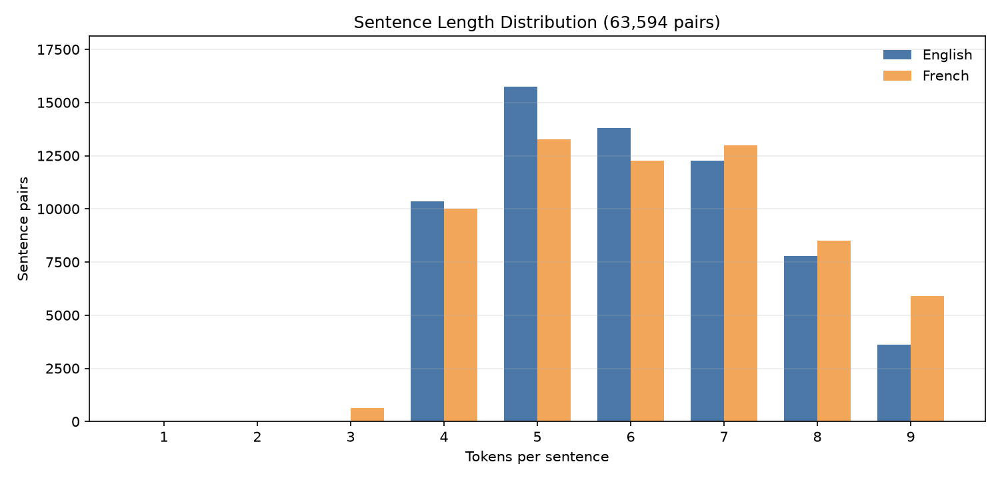
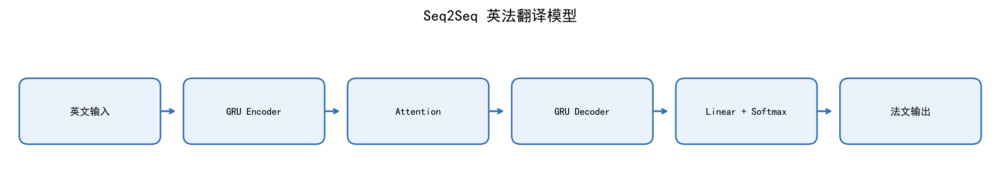
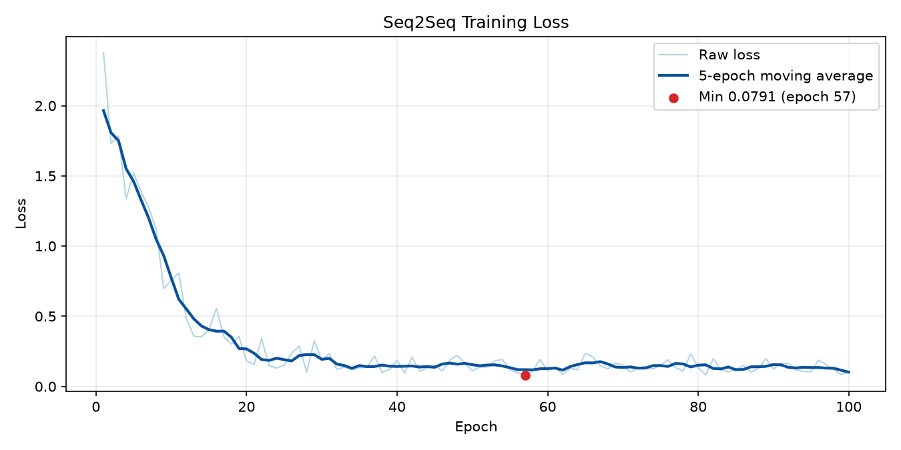
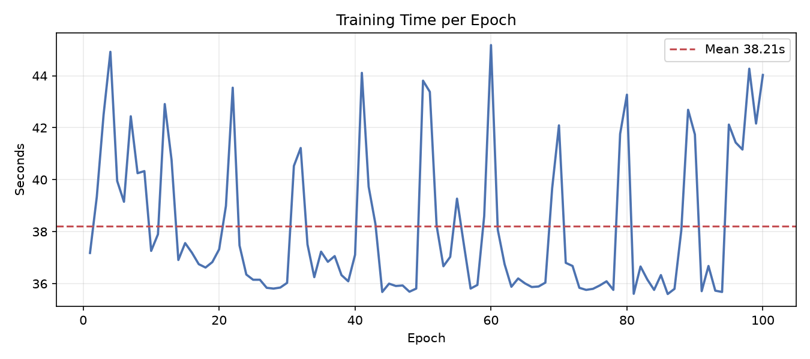

# Seq2Seq 英法翻译

基于 GRU 和注意力机制的英法机器翻译项目，包含数据处理、训练、评估、已训练权重和 100 轮训练损失记录。

## 项目概览

| 项目信息 | 内容 |
| --- | --- |
| 任务类型 | 英文到法文机器翻译 |
| 数据规模 | 63,594 对英法句对 |
| 模型结构 | GRU Encoder + Attention Decoder |
| 训练轮数 | 100 epochs |
| 最低训练损失 | 0.0791（第 57 轮） |
| 权重大小 | encoder 约 4.5 MB，decoder 约 11 MB |

## 目录

1. [项目背景](#项目背景)
2. [数据说明](#数据说明)
3. [模型结构](#模型结构)
4. [训练配置](#训练配置)
5. [训练结果](#训练结果)
6. [环境要求](#环境要求)
7. [安装](#安装)
8. [快速开始](#快速开始)
9. [项目结构](#项目结构)
10. [说明](#说明)
11. [常见问题](#常见问题)

## 项目背景

Seq2Seq（Sequence to Sequence）是神经机器翻译的经典结构：编码器将源语言句子压缩为隐状态，解码器根据隐状态逐词生成目标语言句子。加入注意力机制后，解码器可以在每个时间步关注源句的不同位置，显著提升长句翻译效果。

本项目使用 GRU + Attention 实现英译法翻译，是学习 Transformer 之前的重要基础实践。

## 数据说明

数据文件：src/data/eng-fra-v2.txt，包含 63,594 对英法句对。

格式为 **英文 \t 法文**，每行一个句对。数据样例：

| 英文 | 法文 |
| --- | --- |
| i m . | j ai ans . |
| i m ok . | je vais bien . |
| i m ok . | ca va . |
| i m sorry . | je suis desole . |

数据加载时会做小写化、标点拆分和非法字符过滤，最大序列长度为 10。

句长分布：

63,594 对句子的长度主要集中在 4—9 个 token，短句占多数，最大长度为 9，因此训练时使用最大长度 10 的设置。

## 模型结构

| 组件 | 说明 |
| --- | --- |
| Encoder | 词嵌入 + GRU，hidden_size=256 |
| Decoder | 词嵌入 + Attention + GRU + Linear |
| Attention | 对编码器输出做加权求和，再与当前解码输入拼接 |
| 损失函数 | CrossEntropyLoss |
| 优化器 | Adam |
| 特殊符号 | SOS、EOS、PAD、UNK |

编码器在每个时间步接收一个英文词，输出隐藏状态和编码器输出序列。解码器每一步接收上一个预测词和编码器输出，计算注意力权重后生成下一个法文词。

## 训练配置

| 参数 | 取值 |
| --- | --- |
| batch_size | 32 |
| epochs | 100 |
| hidden_size | 256 |
| max_length | 10 |
| device | GPU（原始项目环境） |
| 每轮耗时 | 约 35–45 秒 |

## 训练结果

| 指标 | 数值 |
| --- | ---: |
| 训练轮数 | 100 |
| 最低 Loss | 0.0791（第 57 轮） |
| 最终 Loss | 约 0.10 |
| 保存权重 | encoder_91.pth / decoder_91.pth |

前 20 轮损失快速下降，之后进入稳定波动区间；第 57 轮达到最低值 0.0791，后续略有波动但整体保持在 0.08—0.20 之间，说明模型已经学到英法句对的基本映射关系。

每轮训练耗时：

100 轮训练平均每轮 38.21 秒，最短 35.60 秒，最长 45.18 秒，总训练时间约 63 分钟。

## 环境要求

- Python 3.10+
- PyTorch 2.0+
- matplotlib、tqdm

## 安装

~~~bash
git clone https://github.com/Smasun0721/seq2seq-en-fr-translation.git
cd seq2seq-en-fr-translation
pip install -r requirements.txt
~~~

## 快速开始

评估已训练模型：

~~~bash
cd src
python 01_英译法案例.py
~~~

重新训练：打开 src/01_英译法案例.py，取消文件底部 train_seq2seq(train_batch_size=32) 的注释后运行。

绘制损失曲线：

~~~bash
cd src
python plot_loss.py
~~~

## 项目结构

~~~text
seq2seq-en-fr-translation/
├── src/
│   ├── 01_英译法案例.py     # 数据、模型、训练与评估
│   ├── plot_loss.py         # 损失曲线绘制
│   ├── data/
│   │   └── eng-fra-v2.txt
│   └── model/
│       ├── encoder_91.pth
│       └── decoder_91.pth
├── reports/
│   ├── training_loss.png
│   └── loss_smoothed.png
├── docs/architecture.png
├── requirements.txt
└── README.md
~~~

## 说明

本项目基于原始课程项目 NLP_Project1/day06 整理，模型结构、训练流程和评估代码保留原实现。仓库附带两个已训练权重（约 15MB），可直接运行评估脚本；数据授权请以原始课程或数据提供方为准。

## 常见问题

**Q：评估脚本提示找不到 encoder_91.pth？**  
确认从 src 目录运行，权重位于 src/model/ 下。

**Q：在 CPU 上能跑吗？**  
可以，但推理速度较慢；训练建议使用 GPU。

**Q：为什么没有单独的验证集指标？**  
原始课程项目只记录了训练损失，未划分验证集；README 中的最低 Loss、最终 Loss 均来自原始训练日志。
